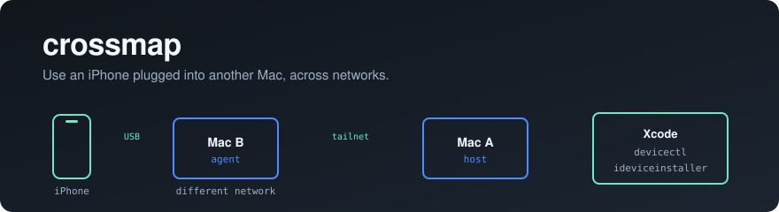

<p align="center">
  
</p>

<p align="center">
  <a href="https://github.com/wtfchewy/crossmap/actions/workflows/ci.yml"></a>
  <a href="https://github.com/wtfchewy/crossmap/releases"></a>
  <a href="LICENSE"></a>
  
</p>

# crossmap

Use an iPhone that is plugged into a different Mac, on a different network, as
if it were plugged into this one.

You plug the phone into the Mac next to you. The Mac that has Xcode, your build
output and your tooling — wherever it is — sees the device and installs apps
onto it. The two Macs only need to reach each other over your tailnet.

```
   iPhone ──USB──> Mac B (agent) ──tailnet──> Mac A (host) ──> Xcode, ideviceinstaller
```

## What makes it work

crossmap is not a USB proxy. It proxies the two *protocols* macOS uses to talk
to an iPhone, at the point where each is a plain socket:

- **usbmuxd**, for lockdown and device services — everything built on
  libimobiledevice.
- **CoreDevice / RemotePairing**, for the trusted tunnel Xcode uses on iOS 17+.

Both are needed: since iOS 17, Xcode's protocol is not carried by usbmuxd, so a
usbmuxd-only proxy gets you app installs but leaves Xcode blind.

Two consequences worth knowing:

- **No re-pairing.** usbmuxd has a `ReadPairRecord` message, so the trust the
  agent's Mac already has with the phone travels over the link. Nothing is
  copied out of `/var/db/lockdown`.
- **Apple still does the crypto.** crossmap never terminates or inspects the
  device's TLS. CoreDevice's certificate-based pairing runs end to end between
  your Mac's `remotepairingd` and the iPhone, exactly as it would over a cable.
  crossmap only fixes discovery and reachability.

[How it works, in detail →](docs/architecture.md)

## Install

```sh
brew install wtfchewy/tap/crossmap
```

Needed on both Macs. [Other install methods →](docs/install.md)

## Quickstart

Pair the two Macs once. On either one:

```sh
crossmap init          # prints a key
```

On the other:

```sh
crossmap join <key>
```

On the Mac the iPhone is plugged into:

```sh
crossmap agent
```

On the Mac with Xcode:

```sh
# libimobiledevice tools, no root
crossmap host --agent other-mac
export USBMUXD_SOCKET_ADDRESS=UNIX:$HOME/.config/crossmap/usbmuxd.sock
ideviceinstaller -i MyApp.ipa

# Xcode and devicectl, which need the system socket
sudo crossmap host --agent other-mac --system
```

Restart Xcode after starting the host — it caches its usbmuxd connection at
launch.

Check either machine with `crossmap doctor`.

[Full usage →](docs/usage.md) · [Troubleshooting →](docs/troubleshooting.md)

## Status

**Covered by tests in this repo:**

- The usbmuxd plane end to end. `internal/integration` runs a fake usbmuxd, an
  agent, a host and a real client in one process, and asserts that a device on
  the agent appears on the host, that its pair record travels, that `Connect`
  proxies a device stream byte-for-byte on the right port, and that
  attach/detach events stream through.
- Wire compatibility with libimobiledevice: the unmodified `idevice_id` binary
  lists a device that exists only on the far side of the link.
- The `dns-sd` browse, resolve and address parsers, against live Bonjour
  traffic.
- The link handshake, including rejection of a wrong key and of peers that are
  not speaking the protocol.
- The agent's relay allowlist.

**Implemented but not yet verified against a physical iPhone:**

- The CoreDevice plane. Discovery, proxy registration and the port relays are
  written and follow the documented behaviour of Bonjour proxying, but have not
  been exercised against a real device over a real link. Expect to need
  `--tunnel-window` tuning; see
  [troubleshooting](docs/troubleshooting.md#pairing-fails-or-the-tunnel-never-establishes).

## Requirements

- macOS on both machines. crossmap drives usbmuxd, `dns-sd` and CoreDevice.
- A tailnet, or any other way the two Macs can reach each other.
- `ideviceinstaller` (`brew install ideviceinstaller`) to install `.ipa` files.

## Security

The link runs over your tailnet and is additionally gated by a pre-shared key
that is never sent over the wire. The agent binds its tailnet address by
default, and will only relay to addresses it discovered on an attached device.

Anyone holding the key can use the devices attached to the agent, including
installing software on them. See [SECURITY.md](SECURITY.md) for the full threat
model and how to report a vulnerability.

## Contributing

See [CONTRIBUTING.md](CONTRIBUTING.md). Most of the system can be developed
without an iPhone attached.

## License

[BSD-3-Clause](LICENSE)
